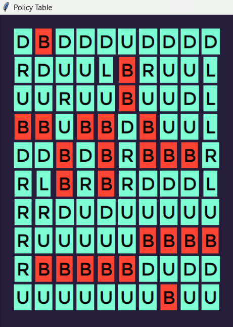

# Maze-Solver--Q_Learning-

* This is first project of AI course in University of Tehran that an Agent has to solve the maze and find the target and collect the flags in its way
* It is a RL problem that we used Q-Learning algorithm in it 
* you can see the results with a GUI that is designed into the program
* you can set the GAMA and ALPHA value in the code and set the maximum lenght that each generated episode can get and the number of the episodes that algorithm should generate to train the agent
<h3>you can see one of the results down here:</h3>

## Code guide

`Main.py` sets the maze and runs the Q-learning demonstration. `Dic_Map_Builder.py` converts map symbols to states, `Episode_Generator.py` samples episodes, `Q_Table.py` updates action values and builds a policy, and `GUI.py` displays that policy with Tkinter. Run `python Main.py` from the repository root in a graphical Python environment. The map and training parameters are defined in the script; change them there to explore other cases.
